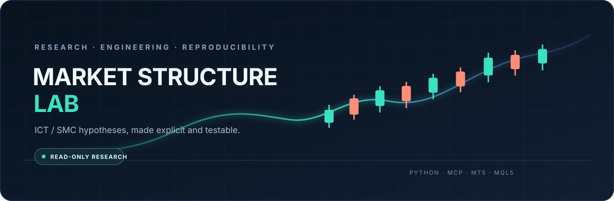
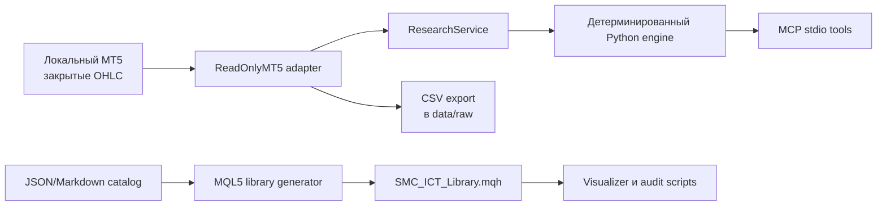

# Market Structure Lab

<div align="center">
  
  <p><strong>Исследовательский инструментарий для формализации и проверки гипотез ICT/SMC.</strong></p>
  <p><a href="https://github.com/WinbyteLab/Market_Structure_Lab/actions/workflows/tests.yml"></a></p>
  <p>Python · MCP · MetaTrader 5 · MQL5</p>
</div>

> **English summary:** A read-only research toolkit for turning ICT/SMC chart ideas into explicit, testable market events. It is not a trading system and makes no profitability claim.

## О проекте

Market Structure Lab разделяет рыночные наблюдения, операционные правила и интерпретации ICT/SMC. Python-движок анализирует закрытые OHLC-бары; read-only MCP-сервер получает данные из локального MetaTrader 5; MQL5-компоненты визуализируют и аудируют ограниченный набор формализованных примитивов.

Проект предназначен для исследования и инженерной проверки гипотез, **не для автоматической торговли**. По одним OHLC-барам нельзя установить личность участника, наличие конкретных resting orders или институциональное намерение.

## Возможности

- Read-only MCP-инструменты: `mt5_status`, `list_symbols`, `symbol_info`, `get_rates`, `analyze_market`, `export_rates_csv`.
- Получение только закрытых баров MT5; лимит запроса ограничен, временные метки приводятся к UTC.
- Детерминированные правила для FVG, подтверждённых swing-пивотов, close-break/BOS/MSS, liquidity-sweep и явно обозначенного order-block proxy.
- Машиночитаемый каталог ICT/SMC-кандидатов и генератор MQL5-реестра.
- Индикатор, аудит-скрипты и тесты на синтетических OHLC-фикстурах.

## Архитектура



## Быстрый старт

Требуется Python `>=3.12,<3.14`. Для чтения локальных котировок дополнительно нужен установленный и запущенный MetaTrader 5.

### Windows

```powershell
py -3.12 -m venv .venv
.\.venv\Scripts\python.exe -m pip install -e ".[mt5,test]"
.\.venv\Scripts\python.exe -m pytest -q
```

### Linux / macOS

```bash
python3.12 -m venv .venv
.venv/bin/python -m pip install -e '.[mt5,test]'
.venv/bin/python -m pytest -q
```

Для запуска MCP-сервера через stdio (обычно его запускает MCP-клиент):

```bash
python -m ict_smc_mcp.server
```

Если MT5 extra не установлен или терминал недоступен, проверка соединения завершится понятной ошибкой; тесты алгоритма работают на фикстурах и не требуют аккаунта брокера.

## Текущее состояние и проверяемые ограничения

Локальная рабочая копия проверена на Windows:

| Проверка | Результат | Граница вывода |
|---|---|---|
| Python suite | **33 passed** | Синтетические и адаптерные тесты, не доказательство edge |
| Генератор библиотеки | **актуален** | Проверяет синхронизацию JSON-каталога и `.mqh` |
| MetaEditor | **0 errors, 0 warnings** в сохранённых логах | Компиляция не равна runtime-проверке в MT5 |
| MCP / котировки | **1000 закрытых баров** проверены локально | Не включены как публичный датасет; источник зависит от локального терминала |
| Запуск MQL5-программ внутри MT5 | **не выполнен** | Бинарники не размещались в каталоге данных терминала |
| Полный исторический backtest / holdout | **не выполнен** | Нет заявления о прибыльности |

Каталог содержит **126 записей-кандидатов**, а не 126 подтверждённых уникальных концепций и не 126 готовых детекторов. Часть правил требует первичных источников, дедупликации, формальной спецификации или ручного/внешнего контекста. Статус `NA` или `NOT_IMPLEMENTED` не означает нулевое число событий.

**Зрелость релиза:** исследовательский прототип; цель — 5/5. Оценка 100/100+ не заявляется, пока не пройдены runtime-, каталоговые и backtest/holdout-гейты. Качество кода и историческая доходность — разные утверждения.

## Проверка и разработка

```bash
python -m pytest -q
python scripts/generate_mql5_library.py --check
```

Для новых правил сначала задайте точное определение и момент доступности сигнала, затем добавьте положительные и отрицательные OHLC-фикстуры. Не используйте будущий touch/confirmation как сигнал, доступный в прошлом. Правила для изменений описаны в [`CONTRIBUTING.md`](CONTRIBUTING.md). Подробные ограничения MQL5: [`docs/MQL5_Запуск_и_ограничения.md`](docs/MQL5_Запуск_и_ограничения.md).

## Безопасность и границы применения

- В MCP нет методов выставления, изменения или закрытия ордеров.
- Account identifiers и account information не запрашиваются.
- Анализ принимает закрытые бары; источник, символ и timeframe возвращаются вместе с результатом.
- Экспорт создаётся только внутри `data/raw/` проекта.
- Результаты — исследовательские гипотезы, не финансовый совет и не доказательство доходности.

## Структура

```text
catalog/      каталог кандидатов, источники и методология
src/          Python engine, MT5 adapter, service и MCP server
scripts/      генерация библиотеки и локальные read-only проверки
include/      MQL5-библиотека
mql5/         индикатор и audit/test scripts
tests/        Python tests и MQL5 harness
docs/         инструкции и эксплуатационные ограничения
```

Локальные `data/`, `reports/`, виртуальные окружения, скачанные материалы и скомпилированные `.ex5` не являются исходниками и не публикуются вместе с репозиторием.

## Лицензия

Лицензия проекта ещё не выбрана. До добавления файла `LICENSE` не считайте исходники предоставленными под open-source лицензией.